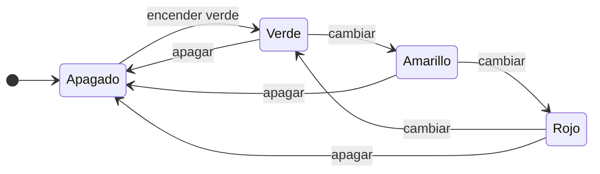
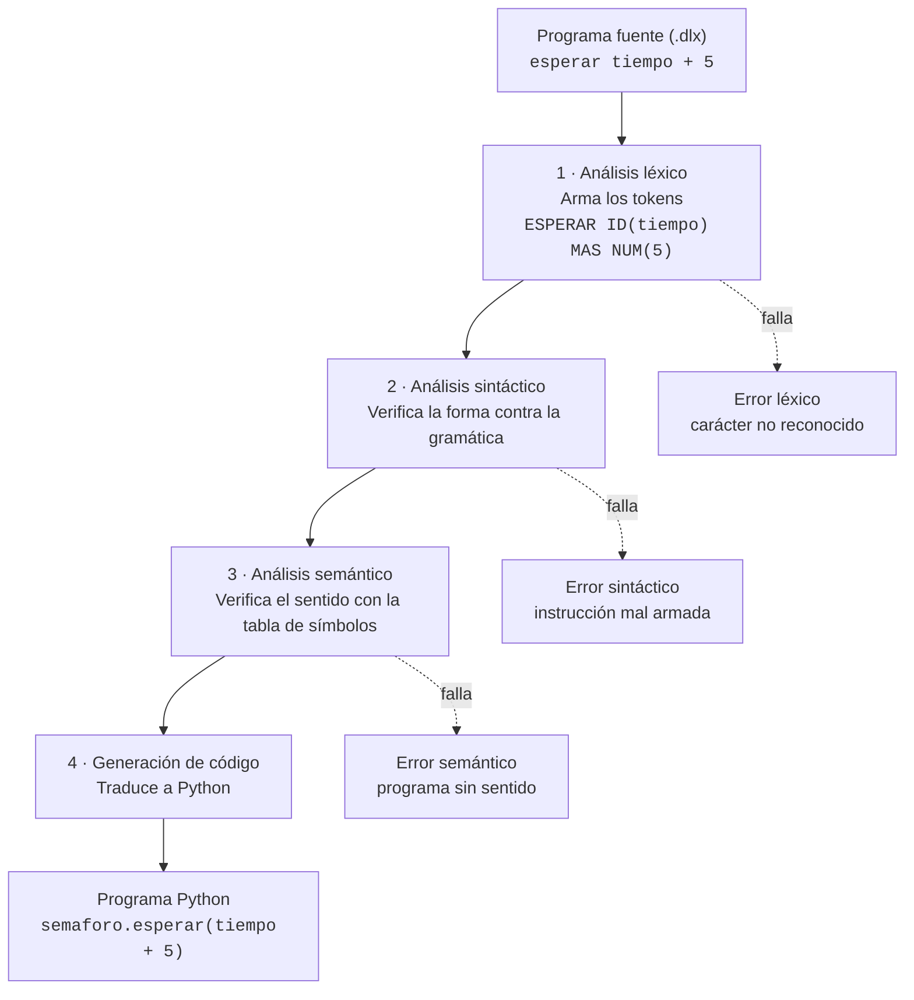

<div align="center">

# 🚦 DeLuX

**Un lenguaje de programación en español para controlar semáforos, con núcleo de propósito general, y su compilador construido desde cero.**

Proyecto «Mi lenguaje, mi compilador» · Tema: **Semáforos** · Compiladores · Fundación Universitaria Claretiana · 2026


[Vistazo rápido](#vistazo-rápido) ·
[Instrucciones del semáforo](#instrucciones-del-tema-semáforos) ·
[Gramática](#gramática-borrador) ·
[Fases del compilador](#fases-del-compilador) ·
[Errores](#manejo-de-errores) ·
[Hoja de ruta](#hoja-de-ruta)

</div>

---

## Contenido

- [¿Qué es DeLuX?](#qué-es-delux)
- [Vistazo rápido](#vistazo-rápido)
- [Referencia del lenguaje](#referencia-del-lenguaje)
  - [Tipos de datos](#tipos-de-datos)
  - [Instrucciones del tema Semáforos](#instrucciones-del-tema-semáforos)
  - [Instrucciones generales](#instrucciones-generales)
  - [Estructuras de control](#estructuras-de-control)
  - [Operadores y precedencia](#operadores-y-precedencia)
  - [Reglas léxicas](#reglas-léxicas)
  - [Palabras reservadas](#palabras-reservadas)
- [Gramática (borrador)](#gramática-borrador)
- [Fases del compilador](#fases-del-compilador)
- [Traducción a Python](#traducción-a-python)
- [Manejo de errores](#manejo-de-errores)
- [Programas de ejemplo](#programas-de-ejemplo)
- [Estructura del repositorio](#estructura-del-repositorio)
- [Hoja de ruta](#hoja-de-ruta)
- [Cómo trabajamos](#cómo-trabajamos)
- [Equipo](#equipo)
- [Referencias](#referencias)

---

## ¿Qué es DeLuX?

DeLuX es un lenguaje **pequeño y legible** para programar el comportamiento de un semáforo. Tiene dos capas:

| Capa | Qué aporta | Ejemplo |
| --- | --- | --- |
| **Instrucciones del tema** | Controlan las luces del semáforo | `encender verde`, `esperar 30`, `cambiar`, `apagar` |
| **Núcleo general** | Variables, decisiones y repeticiones, como en cualquier lenguaje | `si autos > 10 entonces`, `repetir 3 veces`, `leer autos` |

Gracias al núcleo general, un programa no se queda en una lista fija de órdenes: puede decidir cuánto dura el verde según el tráfico, repetir el ciclo las veces que haga falta o preguntarle datos al usuario.

Se apoya en cuatro principios:

| Principio | En la práctica |
| --- | --- |
| **Se lee como español** | `si autos > 10 entonces`, `mientras ciclos > 0 hacer`, `encender rojo` |
| **Una instrucción por línea** | El salto de línea separa instrucciones; no hay `;` |
| **Bloques explícitos** | Todo `si`, `repetir` y `mientras` se cierra con `fin`; la sangría solo da legibilidad |
| **Núcleo pequeño** | Sin funciones, clases ni módulos: lo justo para que el compilador sea completo y entendible |

El compilador recorre las cuatro fases clásicas (análisis léxico, sintáctico y semántico, más la generación de código) y produce **código Python** que maneja un semáforo simulado.

---

## Vistazo rápido

Un semáforo que alarga el verde cuando hay mucho tráfico:

```text
leer autos
si autos > 10 entonces
    tiempo = 30
sino
    tiempo = 15
fin
repetir 3 veces
    encender verde
    esperar tiempo
    cambiar
    esperar 5
    cambiar
    esperar 30
fin
apagar
```

Lo que generará el compilador (Actividad 7):

```python
autos = leer()
if autos > 10:
    tiempo = 30
else:
    tiempo = 15
for _ in range(3):
    semaforo.encender("verde")
    semaforo.esperar(tiempo)
    semaforo.cambiar()
    semaforo.esperar(5)
    semaforo.cambiar()
    semaforo.esperar(30)
semaforo.apagar()
```

> `semaforo` y `leer()` serán parte del código de apoyo que acompaña al programa generado: el semáforo simulado muestra en pantalla qué luz está encendida.

---

## Referencia del lenguaje

### Tipos de datos

Las variables no se declaran: toman el tipo del primer valor que reciben.

| Tipo | Literales | Ejemplo |
| --- | --- | --- |
| **Número** | Enteros o decimales con punto | `tiempo = 30` · `factor = 1.5` |
| **Texto** | Entre comillas dobles, en una sola línea | `mensaje = "Hora pico"` |
| **Lógico** | `verdadero` · `falso` | `nocturno = falso` |
| **Color** | `rojo` · `amarillo` · `verde` | `encender rojo` |

> Los colores solo se usan con `encender`; no se guardan en variables.

### Instrucciones del tema Semáforos

El semáforo tiene tres luces y, como máximo, una encendida a la vez. El ciclo normal es **verde → amarillo → rojo → verde**.

| Instrucción | Sintaxis | Qué hace | Ejemplo |
| --- | --- | --- | --- |
| `encender` | `encender color` | Enciende la luz indicada y apaga las demás | `encender rojo` |
| `esperar` | `esperar N` | Mantiene el semáforo como está durante N segundos | `esperar tiempo + 5` |
| `cambiar` | `cambiar` | Pasa a la siguiente luz del ciclo | `cambiar` |
| `apagar` | `apagar` | Apaga todas las luces | `apagar` |



> `encender color` lleva directo a cualquier luz desde cualquier estado; en el diagrama solo se muestra el arranque para no saturarlo.

### Instrucciones generales

| Instrucción | Sintaxis | Qué hace | Ejemplo |
| --- | --- | --- | --- |
| Asignación | `variable = expresión` | Crea la variable o cambia su valor | `tiempo = base * 2` |
| `mostrar` | `mostrar expresión` | Escribe en pantalla un texto, un número o un resultado | `mostrar "Autos: " + autos` |
| `leer` | `leer variable` | Pide un valor al usuario y lo guarda | `leer autos` |
| Comentario | `# texto` | Se ignora hasta el final de la línea | `# ciclo nocturno` |

### Estructuras de control

**Condición**: el `sino` es opcional.

```text
si autos > 10 entonces
    tiempo = base * 2
sino
    tiempo = base
fin
```

**Repetición fija**: `N` puede ser un número, una variable o una expresión.

```text
repetir 3 veces
    encender verde
    esperar 20
fin
```

**Repetición condicional**: se repite mientras la condición sea verdadera.

```text
mientras ciclos > 0 hacer
    cambiar
    ciclos = ciclos - 1
fin
```

### Operadores y precedencia

De **mayor** a **menor** precedencia. Los paréntesis `( )` cambian el orden.

| Nivel | Operadores | Tipo | Asociatividad |
| :---: | --- | --- | --- |
| 1 | `-` (unario) | Negación numérica | derecha |
| 2 | `*` `/` | Multiplicativos | izquierda |
| 3 | `+` `-` | Aditivos (`+` también une textos) | izquierda |
| 4 | `>` `<` `>=` `<=` `==` `!=` | Comparación | no se encadenan |
| 5 | `no` | Negación lógica | derecha |
| 6 | `y` | Conjunción | izquierda |
| 7 | `o` | Disyunción | izquierda |

Así, `autos + base * 2 > 10 y no nocturno` se lee como `((autos + (base * 2)) > 10) y (no nocturno)`.

### Reglas léxicas

| Elemento | Regla | Válido | No válido |
| --- | --- | --- | --- |
| Identificador | Letra, seguida de letras, dígitos o `_` | `tiempo`, `tiempo_verde`, `ciclo2` | `2ciclo`, `mi-var` |
| Número | Dígitos, con parte decimal opcional después de un punto | `30`, `1.5` | `3.`, `1,5`, `1.000` |
| Texto | `"` … `"` en la misma línea | `"Hora pico"` | `"sin cerrar` |
| Comentario | Desde `#` hasta el fin de línea | `# nota` | — |
| Espacios | Separan tokens; la sangría no tiene significado | — | — |

Cualquier carácter fuera de estas reglas (`@`, `$`, `;`, `&`, `%`…) produce un **error léxico**.

### Palabras reservadas

No se pueden usar como nombres de variable.

```text
Tema Semáforos:   encender  apagar    esperar   cambiar   rojo      amarillo  verde
Generales:        mostrar   leer      si        entonces  sino      fin
                  repetir   veces     mientras  hacer     y         o
                  no        verdadero falso
```

---

## Gramática (borrador)

Notación EBNF. Es la base de la gramática formal que se entregará en la Actividad 5 y puede ajustarse durante la implementación.

```ebnf
programa     = { linea } ;
linea        = [ sentencia ] [ COMENTARIO ] SALTO ;

sentencia    = semaforo
             | asignacion | mostrar | leer
             | condicion  | repetir | mientras ;

(* Instrucciones del tema Semáforos *)
semaforo     = "encender" COLOR
             | "esperar" expresion
             | "cambiar"
             | "apagar" ;
COLOR        = "rojo" | "amarillo" | "verde" ;

(* Instrucciones generales *)
asignacion   = IDENT "=" expresion ;
mostrar      = "mostrar" expresion ;
leer         = "leer" IDENT ;

(* Estructuras de control *)
condicion    = "si" expresion "entonces" SALTO bloque
               [ "sino" SALTO bloque ] "fin" ;
repetir      = "repetir" expresion "veces" SALTO bloque "fin" ;
mientras     = "mientras" expresion "hacer" SALTO bloque "fin" ;
bloque       = { linea } ;

(* Expresiones, de menor a mayor precedencia *)
expresion    = disyuncion ;
disyuncion   = conjuncion { "o" conjuncion } ;
conjuncion   = negacion { "y" negacion } ;
negacion     = "no" negacion | comparacion ;
comparacion  = suma [ OP_COMP suma ] ;
suma         = producto { ( "+" | "-" ) producto } ;
producto     = unario { ( "*" | "/" ) unario } ;
unario       = "-" unario | primario ;
primario     = NUMERO | TEXTO | "verdadero" | "falso"
             | IDENT  | "(" expresion ")" ;

OP_COMP      = ">" | "<" | ">=" | "<=" | "==" | "!=" ;
```

La precedencia de operadores sale directamente de la gramática: cada nivel llama al siguiente, así que `*` se resuelve antes que `+`, y `+` antes que `>`.

---

## Fases del compilador



| Fase | Entrada → salida | Qué revisa en DeLuX |
| --- | --- | --- |
| **Léxico** | Texto → tokens | Que cada carácter forme un token válido: palabras reservadas, colores, identificadores, números, textos y símbolos |
| **Sintáctico** | Tokens → árbol sintáctico | Que las instrucciones sigan la gramática: `encender` lleva un color, `esperar` lleva un tiempo, `si` lleva `entonces` y todo bloque cierra con `fin` |
| **Semántico** | Árbol → árbol verificado | Que las variables existan antes de usarse, que el tiempo de `esperar` sea un número mayor que cero y que no se hagan operaciones aritméticas entre texto y números |
| **Generación** | Árbol verificado → Python | Traduce cada instrucción a su equivalente en Python |

La versión en imagen del diagrama, usada en el documento, está en [`docs/fases-compilador.svg`](docs/fases-compilador.svg).

---

## Traducción a Python

Tabla de equivalencias que seguirá el generador de código:

| DeLuX | Python |
| --- | --- |
| `encender rojo` | `semaforo.encender("rojo")` |
| `esperar N` | `semaforo.esperar(N)` |
| `cambiar` | `semaforo.cambiar()` |
| `apagar` | `semaforo.apagar()` |
| `x = expr` | `x = expr` |
| `mostrar expr` | `print(expr)` |
| `leer x` | `x = leer()` |
| `si c entonces` … `sino` … `fin` | `if c:` … `else:` … |
| `repetir n veces` … `fin` | `for _ in range(n):` … |
| `mientras c hacer` … `fin` | `while c:` … |
| `y` · `o` · `no` | `and` · `or` · `not` |
| `verdadero` · `falso` | `True` · `False` |

---

## Manejo de errores

El compilador se detiene en el **primer error** y lo informa con su tipo, su línea y su columna. Cada fase solo detecta lo que le corresponde, así que cada error lo atrapa la primera fase capaz de notarlo.

| Tipo | Programa de prueba | Causa | Mensaje |
| --- | --- | --- | --- |
| **Léxico** | [`error_lexico.dlx`](ejemplos/errores/error_lexico.dlx) | El carácter `@` no existe en DeLuX | `Línea 2, columna 12: carácter no reconocido '@'` |
| **Sintáctico** | [`error_sintactico.dlx`](ejemplos/errores/error_sintactico.dlx) | `encender` sin color | `Línea 3, columna 9: se esperaba un color (rojo, amarillo o verde) después de 'encender'` |
| **Semántico** | [`error_semantico.dlx`](ejemplos/errores/error_semantico.dlx) | `esperar` con una variable que nunca se definió | `Línea 2, columna 9: la variable 'tiempo_rojo' no está definida` |

<details>
<summary><b>¿Por qué cada error cae en esa fase?</b></summary>

<br/>

- **`@` es léxico:** el analizador léxico no puede convertirlo en ningún token, así que el sintáctico nunca llega a verlo.
- **`encender` sin color es sintáctico:** todos los tokens son válidos; lo que falla es la forma `encender COLOR` que exige la gramática.
- **`tiempo_rojo` sin definir es semántico:** el nombre es válido y `esperar tiempo_rojo` respeta la forma `esperar expresión`. La forma está bien; el significado no. Solo la tabla de símbolos revela que la variable no existe.

</details>

**Reglas semánticas previstas para la Actividad 7:**

1. No se puede usar una variable antes de definirla.
2. El tiempo de `esperar` debe ser un número mayor que cero.
3. No se permiten operaciones aritméticas entre texto y números (sí se pueden unir textos con `+`).

---

## Programas de ejemplo

| Archivo | Qué demuestra |
| --- | --- |
| [`correctos/ciclo.dlx`](ejemplos/correctos/ciclo.dlx) | Las cuatro instrucciones del tema en un ciclo normal |
| [`correctos/ciclos.dlx`](ejemplos/correctos/ciclos.dlx) | `repetir`, variables y suma para calcular el tiempo del rojo |
| [`correctos/trafico.dlx`](ejemplos/correctos/trafico.dlx) | `leer`, `si … sino`, multiplicación, `mientras` y resta |
| [`errores/error_lexico.dlx`](ejemplos/errores/error_lexico.dlx) | Error léxico: carácter `@` |
| [`errores/error_sintactico.dlx`](ejemplos/errores/error_sintactico.dlx) | Error sintáctico: `encender` sin color |
| [`errores/error_semantico.dlx`](ejemplos/errores/error_semantico.dlx) | Error semántico: variable no definida |

---

## Estructura del repositorio

```text
.
├── README.md                           ← estás aquí
├── BITACORA.md                         ← decisiones del grupo y uso de IA
├── Actividad3_DeLuX_Compiladores.docx  ← documento de la Actividad 3
├── docs/
│   ├── Actividad3_DeLuX_Compiladores.pdf
│   ├── fases-compilador.svg
│   └── fases-compilador.png
└── ejemplos/
    ├── correctos/                      ← programas válidos
    └── errores/                        ← un error intencional por archivo
```

---

## Hoja de ruta

### ✅ Actividad 3 · Conceptualización básica

- [x] Definir las instrucciones del tema, los tipos de datos y las estructuras de control
- [x] Dibujar las fases del compilador y explicar cada una
- [x] Escribir tres programas correctos
- [x] Escribir tres programas con errores (léxico, sintáctico y semántico) y explicarlos
- [x] Aplicar la retroalimentación del docente (instrucciones del tema Semáforos)

### ⏳ Actividad 5 · Análisis léxico y sintáctico

- [ ] Elegir el lenguaje de implementación del compilador
- [ ] Decidir si se recortan extensiones del lenguaje para simplificar el lexer y el parser
- [ ] Analizador léxico: leer un `.dlx` y producir la lista de tokens
- [ ] Reportar caracteres no reconocidos con línea y columna
- [ ] Escribir la gramática formal en su propio archivo
- [ ] Analizador sintáctico que valide la estructura contra la gramática
- [ ] Probar con los seis programas actuales más tres nuevos y guardar los resultados

### ⏳ Actividad 7 · Trabajo final

- [ ] Tabla de símbolos y error por variable no definida
- [ ] Tres reglas semánticas, con regla y línea en cada error
- [ ] Generación de código: traducción a Python con semáforo simulado
- [ ] Reflexión escrita sobre lo más difícil y las decisiones tomadas

---

## Cómo trabajamos

- **Commits propios y frecuentes.** Cada integrante sube su trabajo a medida que avanza, no todo al final.
- **Mensajes en español y en infinitivo**, que digan qué cambia: `Agregar analizador léxico`, `Corregir columna en errores léxicos`.
- **Toda decisión va a la [bitácora](BITACORA.md)**, con su fecha y su porqué, incluido el uso de herramientas de IA.
- **Todo el equipo entiende todo.** En la defensa, el docente puede preguntarle a cualquiera sobre cualquier parte, así que el trabajo se reparte pero se explica entre los dos.

---

## Equipo

| Integrante | Rol |
| --- | --- |
| **Deiner David Bello González** · [Bello2005](https://github.com/Bello2005) | Diseño del lenguaje y desarrollo |
| **Luvis Yorfari Correa Mosquera** | Diseño del lenguaje y desarrollo |

**Docente:** Hasler Gamboa Berrio
**Asignatura:** Compiladores · Programa de Ingeniería de Sistemas · Fundación Universitaria Claretiana

---

## Referencias

- Aho, A. V., Lam, M. S., Sethi, R., & Ullman, J. D. (2006). *Compilers: Principles, techniques, and tools* (2nd ed.). Pearson / Addison-Wesley.
- Wirth, N. (1996). *Compiler construction*. Addison-Wesley.
- Gamboa Berrio, H. (2026). *Proyecto de compiladores: Mi lenguaje, mi compilador* [Guía de actividad]. Fundación Universitaria Claretiana.

<div align="center">
<br/>
<sub>Proyecto académico · Compiladores 2026 · Hecho en Quibdó, Chocó</sub>
</div>
