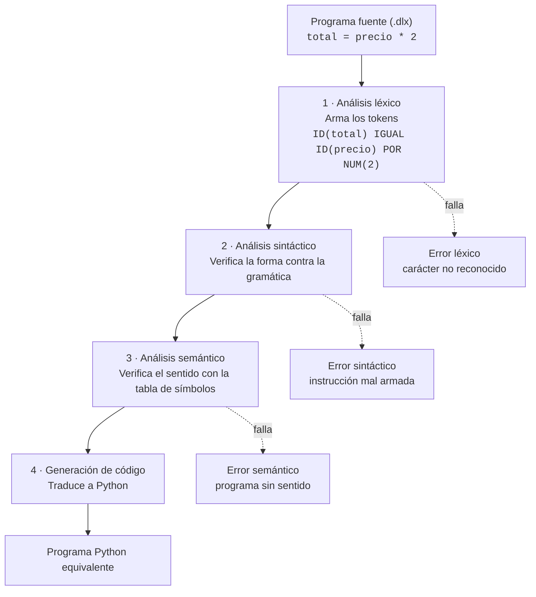

<div align="center">

# DeLuX

**Un lenguaje de programación de propósito general, en español, y su compilador construido desde cero.**

Proyecto «Mi lenguaje, mi compilador» · Compiladores · Fundación Universitaria Claretiana · 2026


[Vistazo rápido](#vistazo-rápido) ·
[Referencia del lenguaje](#referencia-del-lenguaje) ·
[Gramática](#gramática-borrador) ·
[Fases del compilador](#fases-del-compilador) ·
[Errores](#manejo-de-errores) ·
[Hoja de ruta](#hoja-de-ruta)

</div>

---

## Contenido

- [¿Qué es DeLuX?](#qué-es-delux)
- [Vistazo rápido](#vistazo-rápido)
- [Referencia del lenguaje](#referencia-del-lenguaje)
  - [Tipos de datos](#tipos-de-datos)
  - [Instrucciones](#instrucciones)
  - [Estructuras de control](#estructuras-de-control)
  - [Operadores y precedencia](#operadores-y-precedencia)
  - [Reglas léxicas](#reglas-léxicas)
  - [Palabras reservadas](#palabras-reservadas)
- [Gramática (borrador)](#gramática-borrador)
- [Fases del compilador](#fases-del-compilador)
- [Traducción a Python](#traducción-a-python)
- [Manejo de errores](#manejo-de-errores)
- [Programas de ejemplo](#programas-de-ejemplo)
- [Estructura del repositorio](#estructura-del-repositorio)
- [Hoja de ruta](#hoja-de-ruta)
- [Cómo trabajamos](#cómo-trabajamos)
- [Equipo](#equipo)
- [Referencias](#referencias)

---

## ¿Qué es DeLuX?

DeLuX es un lenguaje **pequeño, legible y de propósito general**. No está hecho para un solo problema: sirve para hacer cálculos, pedir datos al usuario, tomar decisiones y repetir tareas, igual que Python sirve para inteligencia artificial o para páginas web sin haber sido diseñado solo para eso.

Se apoya en cuatro ideas:

| Principio | En la práctica |
| --- | --- |
| **Se lee como español** | `si nota >= 3.0 entonces`, `mientras intentos > 0 hacer`, `mostrar "Hola"` |
| **Una instrucción por línea** | El salto de línea separa instrucciones; no hay `;` |
| **Bloques explícitos** | Todo `si`, `repetir` y `mientras` se cierra con `fin`; la sangría solo da legibilidad |
| **Núcleo pequeño** | Sin funciones, clases ni módulos: lo justo para que el compilador sea completo y entendible |

El compilador recorre las cuatro fases clásicas (análisis léxico, sintáctico y semántico, más la generación de código) y produce como resultado **código Python equivalente**, listo para ejecutarse.

---

## Vistazo rápido

Un programa en DeLuX (`ejemplos/correctos/tabla.dlx`):

```text
leer numero
contador = 1
repetir 10 veces
    mostrar numero * contador
    contador = contador + 1
fin
```

Lo que generará el compilador (Actividad 7):

```python
numero = leer()
contador = 1
for _ in range(10):
    print(numero * contador)
    contador = contador + 1
```

> `leer()` será una función auxiliar del código generado: lee una línea y la convierte en número cuando es posible.

---

## Referencia del lenguaje

### Tipos de datos

Las variables no se declaran: toman el tipo del primer valor que reciben.

| Tipo | Literales | Ejemplo |
| --- | --- | --- |
| **Número** | Enteros o decimales con punto | `edad = 20` · `nota = 4.5` |
| **Texto** | Entre comillas dobles, en una sola línea | `nombre = "Ana"` |
| **Lógico** | `verdadero` · `falso` | `activo = verdadero` |

### Instrucciones

| Instrucción | Sintaxis | Qué hace | Ejemplo |
| --- | --- | --- | --- |
| Asignación | `variable = expresión` | Crea la variable o cambia su valor | `total = precio * 2` |
| `mostrar` | `mostrar expresión` | Escribe en pantalla un texto, un número o un resultado | `mostrar "Hola " + nombre` |
| `leer` | `leer variable` | Pide un valor al usuario y lo guarda | `leer edad` |
| Comentario | `# texto` | Se ignora hasta el final de la línea | `# calcula el total` |

### Estructuras de control

**Condición**: el `sino` es opcional.

```text
si nota >= 3.0 entonces
    mostrar "Aprobado"
sino
    mostrar "Reprobado"
fin
```

**Repetición fija**: `N` puede ser un número, una variable o una expresión.

```text
repetir 3 veces
    mostrar "DeLuX"
fin
```

**Repetición condicional**: se repite mientras la condición sea verdadera.

```text
mientras intentos > 0 hacer
    intentos = intentos - 1
fin
```

### Operadores y precedencia

De **mayor** a **menor** precedencia. Los paréntesis `( )` cambian el orden.

| Nivel | Operadores | Tipo | Asociatividad |
| :---: | --- | --- | --- |
| 1 | `-` (unario) | Negación numérica | derecha |
| 2 | `*` `/` | Multiplicativos | izquierda |
| 3 | `+` `-` | Aditivos (`+` también une textos) | izquierda |
| 4 | `>` `<` `>=` `<=` `==` `!=` | Comparación | no se encadenan |
| 5 | `no` | Negación lógica | derecha |
| 6 | `y` | Conjunción | izquierda |
| 7 | `o` | Disyunción | izquierda |

Así, `a + b * 2 > 10 y activo` se lee como `((a + (b * 2)) > 10) y activo`.

### Reglas léxicas

| Elemento | Regla | Válido | No válido |
| --- | --- | --- | --- |
| Identificador | Letra, seguida de letras, dígitos o `_` | `total`, `nota_final`, `x2` | `2x`, `mi-var` |
| Número | Dígitos, con parte decimal opcional después de un punto | `15`, `3.5` | `3.`, `1,5`, `1.000` |
| Texto | `"` … `"` en la misma línea | `"Hola mundo"` | `"sin cerrar` |
| Comentario | Desde `#` hasta el fin de línea | `# nota` | — |
| Espacios | Separan tokens; la sangría no tiene significado | — | — |

Cualquier carácter fuera de estas reglas (`@`, `$`, `;`, `&`, `%`…) produce un **error léxico**.

### Palabras reservadas

No se pueden usar como nombres de variable.

```text
mostrar   leer      si        entonces  sino      fin
repetir   veces     mientras  hacer     y         o
no        verdadero falso
```

---

## Gramática (borrador)

Notación EBNF. Es la base de la gramática formal que se entregará en la Actividad 5 y puede ajustarse durante la implementación.

```ebnf
programa     = { linea } ;
linea        = [ sentencia ] [ COMENTARIO ] SALTO ;

sentencia    = asignacion | mostrar | leer
             | condicion  | repetir | mientras ;

asignacion   = IDENT "=" expresion ;
mostrar      = "mostrar" expresion ;
leer         = "leer" IDENT ;

condicion    = "si" expresion "entonces" SALTO bloque
               [ "sino" SALTO bloque ] "fin" ;
repetir      = "repetir" expresion "veces" SALTO bloque "fin" ;
mientras     = "mientras" expresion "hacer" SALTO bloque "fin" ;
bloque       = { linea } ;

expresion    = disyuncion ;
disyuncion   = conjuncion { "o" conjuncion } ;
conjuncion   = negacion { "y" negacion } ;
negacion     = "no" negacion | comparacion ;
comparacion  = suma [ OP_COMP suma ] ;
suma         = producto { ( "+" | "-" ) producto } ;
producto     = unario { ( "*" | "/" ) unario } ;
unario       = "-" unario | primario ;
primario     = NUMERO | TEXTO | "verdadero" | "falso"
             | IDENT  | "(" expresion ")" ;

OP_COMP      = ">" | "<" | ">=" | "<=" | "==" | "!=" ;
```

La precedencia de operadores sale directamente de la gramática: cada nivel llama al siguiente, y así `*` se resuelve antes que `+`, y `+` antes que `>`.

---

## Fases del compilador



| Fase | Entrada → salida | Qué revisa en DeLuX |
| --- | --- | --- |
| **Léxico** | Texto → tokens | Que cada carácter forme un token válido: palabras reservadas, identificadores, números, textos y símbolos |
| **Sintáctico** | Tokens → árbol sintáctico | Que las instrucciones sigan la gramática: `si` lleva `entonces`, `mientras` lleva `hacer` y todo bloque cierra con `fin` |
| **Semántico** | Árbol → árbol verificado | Que las variables existan antes de usarse, que no se mezclen textos y números en operaciones aritméticas y que `repetir` no reciba valores negativos |
| **Generación** | Árbol verificado → Python | Traduce cada instrucción a su equivalente en Python |

La versión en imagen del diagrama está en [`docs/actividad-3/fases-compilador.svg`](docs/actividad-3/fases-compilador.svg).

---

## Traducción a Python

Tabla de equivalencias que seguirá el generador de código:

| DeLuX | Python |
| --- | --- |
| `x = expr` | `x = expr` |
| `mostrar expr` | `print(expr)` |
| `leer x` | `x = leer()` |
| `si c entonces` … `sino` … `fin` | `if c:` … `else:` … |
| `repetir n veces` … `fin` | `for _ in range(n):` … |
| `mientras c hacer` … `fin` | `while c:` … |
| `y` · `o` · `no` | `and` · `or` · `not` |
| `verdadero` · `falso` | `True` · `False` |
| `# comentario` | `# comentario` |

---

## Manejo de errores

El compilador se detiene en el **primer error** y lo informa con su tipo, su línea y su columna. Cada fase solo detecta lo que le corresponde, así que cada error lo atrapa la primera fase capaz de notarlo.

| Tipo | Programa de prueba | Causa | Mensaje |
| --- | --- | --- | --- |
| **Léxico** | [`error_lexico.dlx`](ejemplos/errores/error_lexico.dlx) | El carácter `@` no existe en DeLuX | `Línea 3, columna 27: carácter no reconocido '@'` |
| **Sintáctico** | [`error_sintactico.dlx`](ejemplos/errores/error_sintactico.dlx) | Un `si` sin `entonces` | `Línea 2, columna 14: se esperaba 'entonces' después de la condición` |
| **Semántico** | [`error_semantico.dlx`](ejemplos/errores/error_semantico.dlx) | Se usa `valor` sin haberla definido | `Línea 3, columna 19: la variable 'valor' no está definida` |

<details>
<summary><b>¿Por qué cada error cae en esa fase?</b></summary>

<br/>

- **`@` es léxico:** el analizador léxico no puede convertirlo en ningún token, así que el sintáctico nunca llega a verlo.
- **El `si` sin `entonces` es sintáctico:** todos los tokens son válidos; lo que falla es el orden que exige la gramática.
- **`valor` sin definir es semántico:** el nombre es válido y `suma = suma + valor` respeta la forma `variable = expresión`. La forma está bien; el significado no. Solo la tabla de símbolos revela que `valor` no existe.

</details>

---

## Programas de ejemplo

| Archivo | Qué demuestra |
| --- | --- |
| [`correctos/area.dlx`](ejemplos/correctos/area.dlx) | Variables, multiplicación y `mostrar` con texto y números |
| [`correctos/tabla.dlx`](ejemplos/correctos/tabla.dlx) | `leer`, `repetir`, suma y multiplicación |
| [`correctos/nota.dlx`](ejemplos/correctos/nota.dlx) | `si … sino`, comparación, decimales, `mientras` y resta |
| [`errores/error_lexico.dlx`](ejemplos/errores/error_lexico.dlx) | Error léxico: carácter `@` |
| [`errores/error_sintactico.dlx`](ejemplos/errores/error_sintactico.dlx) | Error sintáctico: falta `entonces` |
| [`errores/error_semantico.dlx`](ejemplos/errores/error_semantico.dlx) | Error semántico: variable no definida |

---

## Estructura del repositorio

```text
.
├── README.md                     ← estás aquí
├── BITACORA.md                   ← decisiones del grupo y su porqué
├── docs/
│   ├── actividad-3/
│   │   ├── Actividad3_DeLuX_Compiladores.docx
│   │   ├── Actividad3_DeLuX_Compiladores.pdf
│   │   ├── fases-compilador.svg
│   │   └── fases-compilador.png
│   └── historial/
│       └── Actividad3_SEMA_Compiladores_v0.docx   ← primera versión (descartada)
└── ejemplos/
    ├── correctos/                ← programas válidos
    └── errores/                  ← un error intencional por archivo
```

---

## Hoja de ruta

### ✅ Actividad 3 · Conceptualización básica

- [x] Definir instrucciones, tipos de datos y estructuras de control
- [x] Dibujar las fases del compilador y explicar cada una
- [x] Escribir tres programas correctos
- [x] Escribir tres programas con errores (léxico, sintáctico y semántico) y explicarlos
- [x] Documento entregable: [`docs/actividad-3`](docs/actividad-3)

### ⏳ Actividad 5 · Análisis léxico y sintáctico

- [ ] Elegir el lenguaje de implementación del compilador
- [ ] Analizador léxico: leer un `.dlx` y producir la lista de tokens
- [ ] Reportar caracteres no reconocidos con línea y columna
- [ ] Escribir la gramática formal en su propio archivo
- [ ] Analizador sintáctico que valide la estructura contra la gramática
- [ ] Probar con los seis programas actuales más tres nuevos y guardar los resultados

### ⏳ Actividad 7 · Trabajo final

- [ ] Tabla de símbolos y error por variable no definida
- [ ] Tres reglas semánticas propias, con regla y línea en cada error
- [ ] Generación de código: traducción a Python
- [ ] Reflexión escrita sobre lo más difícil y las decisiones tomadas

---

## Cómo trabajamos

- **Commits propios y frecuentes.** Cada integrante sube su trabajo a medida que avanza, no todo al final.
- **Mensajes en español y en infinitivo**, que digan qué cambia: `Agregar analizador léxico`, `Corregir columna en errores léxicos`.
- **Toda decisión va a la [bitácora](BITACORA.md)**, con su fecha y su porqué.
- **Todo el equipo entiende todo.** En la defensa, el docente puede preguntarle a cualquiera sobre cualquier parte, así que el trabajo se reparte pero se explica entre los dos.

---

## Equipo

| Integrante | Rol |
| --- | --- |
| **Deiner David Bello González** · [Bello2005](https://github.com/Bello2005) | Diseño del lenguaje y desarrollo |
| **Luvis Yorfari Correa Mosquera** | Diseño del lenguaje y desarrollo |

**Docente:** Hasler Gamboa Berrio
**Asignatura:** Compiladores · Programa de Ingeniería de Sistemas · Fundación Universitaria Claretiana

---

## Referencias

- Aho, A. V., Lam, M. S., Sethi, R., & Ullman, J. D. (2006). *Compilers: Principles, techniques, and tools* (2nd ed.). Pearson / Addison-Wesley.
- Wirth, N. (1996). *Compiler construction*. Addison-Wesley.
- Gamboa Berrio, H. (2026). *Proyecto de compiladores: Mi lenguaje, mi compilador* [Guía de actividad]. Fundación Universitaria Claretiana.

<div align="center">
<br/>
<sub>Proyecto académico · Compiladores 2026 · Hecho en Quibdó, Chocó</sub>
</div>
